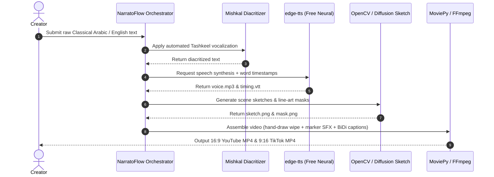

# System Requirements Document (SRD)
## Project: Open-Source Whiteboard & Sketch AI Video Engine ("NarratoFlow")

> **Status:** v1.0 (original draft). See [`REVIEW.md`](REVIEW.md) for the technical review and proposed v1.1 amendments.

---

## 1. System Architecture Overview

The system is designed as a modular, standalone Python pipeline with optional local GPU acceleration, requiring **zero paid external APIs**.

```
                           ┌────────────────────────────┐
                           │   Input Text / Document    │
                           └─────────────┬──────────────┘
                                         ▼
                           ┌────────────────────────────┐
                           │  Classical Arabic Engine   │
                           │  - pyarabic + mishkal      │
                           └─────────────┬──────────────┘
                                         ▼
                           ┌────────────────────────────┐
                           │   Script & Scene Parser    │
                           │ (Local Ollama / Free LLM)  │
                           └─────────────┬──────────────┘
                                         │
            ┌────────────────────────────┼────────────────────────────┐
            ▼                            ▼                            ▼
┌───────────────────────┐    ┌───────────────────────┐    ┌───────────────────────┐
│ Free TTS Engine       │    │ Open Sketch Processor │    │ FOSS Sound Engine     │
│ - edge-tts (Zero-Key) │    │ - OpenCV line-art     │    │ - CC0 Whiteboard SFX  │
│ - Piper / XTTS-v2     │    │ - Potrace SVG tracer  │    │ - pydub audio mixer   │
│ - Word Timestamps     │    │ - Diffusers LineArt   │    │ - Auto-ducking filter │
└───────────┬───────────┘    └───────────┬───────────┘    └───────────┬───────────┘
            │                            │                            │
            └────────────────────────────┼────────────────────────────┘
                                         │ Storyboard Elements
                                         ▼
                           ┌────────────────────────────┐
                           │ Whiteboard Compositor      │
                           │ - Hand-drawing wipe mask   │
                           │ - BiDi Libass captions     │
                           │ - FFmpeg / MoviePy engine  │
                           └─────────────┬──────────────┘
                                         ▼
                           ┌────────────────────────────┐
                           │ Output: 16:9 & 9:16 MP4    │
                           └────────────────────────────┘
```

---

## 2. Core Service Modules & Technical Specifications

### 2.1 Module 1: Classical Arabic NLP & Diacritization (`mishkal-tashkeel`)
- **Package**: `pyarabic`, `mishkal` (open-source Python library).
- **Functionality**:
  - Validates text against Classical Arabic grammar rules and excludes colloquial forms.
  - Automatically enriches text with diacritical marks (*Harakat / Tashkeel*):
    ```python
    import mishkal.tashkeel as tashkeel

    vocalizer = tashkeel.TashkeelClass()
    vocalized_arabic = vocalizer.tashkeel_text(raw_classical_text)
    ```
  - Ensures correct case-ending pronunciation (*I'rab*) during speech synthesis.

### 2.2 Module 2: Free Neural Voice Synthesis & Alignment (`edge-tts`)
- **Package**: `edge-tts` (100% free, zero authentication required).
- **Voices Selected**:
  - **Classical Arabic**:
    - `ar-SA-HamedNeural` (Male, authoritative, clear classical Fusha elocution).
    - `ar-SA-ZariyahNeural` (Female, articulate classical delivery).
  - **English**:
    - `en-US-GuyNeural` / `en-US-JennyNeural` / `en-GB-RyanNeural`.
- **Word-Level Subtitle Synchronization**:
  - `edge-tts` emits native SubRip/WebVTT timing markers with millisecond precision:
    ```python
    import edge_tts

    communicate = edge_tts.Communicate(
        text=vocalized_arabic,
        voice="ar-SA-HamedNeural",
        rate="+0%",
        pitch="+0Hz"
    )
    # Yields audio chunks and SubMaker word boundaries
    ```
- **Local Fallback Engine**: `piper-tts` or `coqui-tts` for 100% offline, air-gapped CPU/GPU speech synthesis.

### 2.3 Module 3: Open-Source Sketch & Doodle Generation Engine
To generate whiteboard line art without paid image APIs, NarratoFlow uses a hybrid approach:

#### Pipeline A: Algorithmic Image-to-Whiteboard Converter (OpenCV + Potrace)
- Converts any photo, diagram, or clipart into a clean marker sketch:
  ```python
  import cv2
  import numpy as np


  def image_to_whiteboard_sketch(image_path: str, output_path: str):
      img = cv2.imread(image_path)
      gray = cv2.cvtColor(img, cv2.COLOR_BGR2GRAY)
      inv_gray = cv2.bitwise_not(gray)
      blurred = cv2.GaussianBlur(inv_gray, (21, 21), sigmaX=0, sigmaY=0)
      sketch = cv2.divide(gray, 255 - blurred, scale=256)
      # Threshold to clean up background to pure white (#FFFFFF)
      _, binary_sketch = cv2.threshold(sketch, 240, 255, cv2.THRESH_BINARY)
      cv2.imwrite(output_path, binary_sketch)
  ```
- **Vector Tracing**: Uses `potrace` to convert high-contrast bitmap sketches into clean, infinitely scalable SVG line paths.

#### Pipeline B: Open-Weights Diffusion Model (Diffusers)
- For generating original sketches from text prompts:
  - Model: Stable Diffusion XL Turbo / SD 1.5 with `LineArt` ControlNet or Sketch LoRA.
  - Can run on local GPUs ($\ge 6\text{ GB VRAM}$) or free Google Colab/Kaggle instances.

#### Pipeline C: Bundled FOSS Vector Icon Library
- Ships with an embedded offline collection of $\sim 500$ open-source whiteboard vectors (arrows, thinking bubbles, scrolls, scales of justice, lightbulbs, book icons) in SVG format.

---

### 2.4 Module 4: FOSS Whiteboard Animation Compositor (MoviePy & FFmpeg)

The whiteboard animation effect is created programmatically without proprietary tools:

1. **Simulated Hand-Drawn Stroke Reveal**:
   - A diagonal or path-based alpha mask progressively reveals the sketch image from top-left to bottom-right over the duration of the scene's audio.
   - An optional transparent PNG hand holding a dry-erase marker is animated at the moving leading edge of the mask.
2. **Audio-Synchronized Sound Effects**:
   - Local CC0 marker squeak audio is looped and mixed specifically during the visual reveal duration.
3. **Aspect Ratio Layouts**:
   - **YouTube (16:9, `1920x1080`)**: Panoramic whiteboard canvas; sketches appear side-by-side or connect with animated sketched arrows.
   - **TikTok (9:16, `1080x1920`)**: Vertical whiteboard canvas; sketches stack centrally, with dynamic upward camera scroll transitions between scenes.

---

### 2.5 Module 5: Open-Source Subtitle & Arabic BiDi Engine
- **Font Assets**:
  - `Amiri-Bold.ttf` (SIL Open Font License) for Classical Arabic.
  - `Montserrat-ExtraBold.ttf` for English.
- **BiDi Text Processing**:
  - Employs `python-bidi` and `arabic-reshaper` to ensure Arabic words connect in correct cursive order before rendering in subtitle streams:
    ```python
    import arabic_reshaper
    from bidi.algorithm import get_display

    reshaped_text = arabic_reshaper.reshape(vocalized_arabic_line)
    bidi_text = get_display(reshaped_text)
    ```
- **Subtitle Formatting (`.ass`)**:
  - Styled with high-contrast outlines (White fill, Black 4px border) or black marker text on a semi-transparent paper card overlay.

---

## 3. Human-in-the-Loop Review Station (Gradio / Streamlit)

NarratoFlow provides an optional lightweight, local web interface:
- **Built with**: `Gradio` or `Streamlit` (pure Python, zero frontend build step).
- **Features**:
  - Side-by-side preview of generated audio, Tashkeel text, and sketch visuals per scene.
  - One-click buttons to:
    - Edit Classical Arabic vowels/Tashkeel.
    - Re-generate sketch with alternative line-art prompt or upload custom drawing.
    - Re-align subtitle timings.
  - Batch "Export YouTube (16:9)" and "Export TikTok (9:16)" buttons.

---

## 4. Software Dependencies & Installation Requirements

```txt
# Core Audio & NLP
edge-tts>=6.1.0
pyarabic>=0.6.14
mishkal>=0.4.0
pydub>=0.25.1
faster-whisper>=1.0.0

# Computer Vision & Vector Processing
opencv-python-headless>=4.8.0
numpy>=1.24.0
pillow>=10.0.0
cairosvg>=2.7.0

# Video Compositing
moviepy>=1.0.3
ffmpeg-python>=0.2.0

# Arabic Text Shaping & Subtitles
arabic-reshaper>=3.0.0
python-bidi>=0.4.2
pysubs2>=1.6.1

# Optional UI & Local LLM
streamlit>=1.30.0
requests>=2.31.0
```

---

## 5. Execution Pipeline Summary


